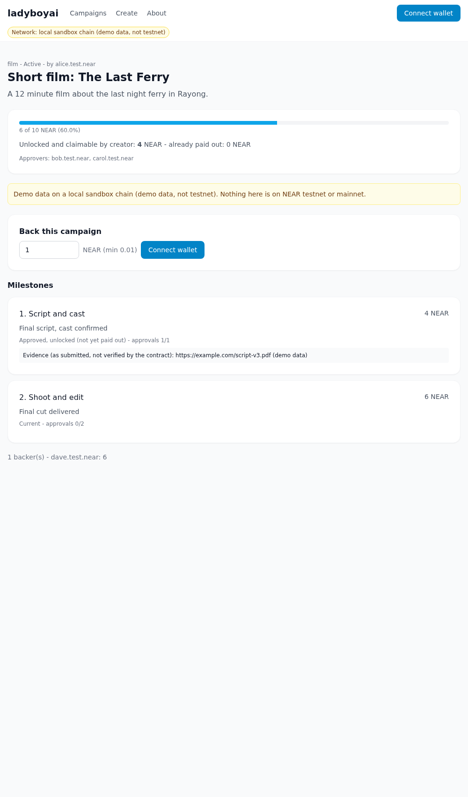

# ladyboyai - milestone escrow for creator funding (demo, not yet deployed to testnet)

Backers put NEAR in escrow. The creator posts evidence per milestone. Approvers named at creation must sign off before that milestone's share can be withdrawn. If the creator cancels, unreleased money goes back to backers pro rata.



## What is verified
| Check | Result |
|---|---|
| Rust unit tests (`npm run test:contract`) | 35 pass, includes adversarial cases (double claim, self-approve, evidence swap, overfunding, double refund, stranger claims) |
| End-to-end on a local NEAR sandbox chain (`npm run test:e2e`) | 4 pass: create > fund > evidence > approve > payout with real balance changes, overfund rejected with deposit returned, cancel + pro rata refund, frontend RPC client reads same state |
| Frontend: `tsc`, `vite build`, 3 unit tests (`npm test`) | pass |
| UI rendered against the local sandbox chain (screenshots in `docs/`) | home, campaigns, create, campaign detail |

## What is NOT verified or not built
- Not deployed to NEAR testnet yet (needs your own account, see `docs/DEPLOY.md`).
- Wallet signing in a real browser is untested. Reads work; writes go through NEAR Wallet Selector (MyNearWallet).
- NEAR only. No USDC, no cross-chain funding, no NEAR Intents integration.
- The contract cannot verify evidence. Approvers are chosen by the creator.
- No deadlines or disputes. Unaudited. Do not use real money.

## Run
```bash
npm install
npm test && npm run test:contract
npm run build:contract && npm run test:e2e     # needs rust + node 22
VITE_CONTRACT_ID=<deployed id> npm run dev
```

## Other project by the same author (disclosure)

The author also entered a separate, independent project in this hackathon: The Fucking Pawnshop (https://github.com/ladyboyai/thefuckingpawnshop). It shares no code with this project.
